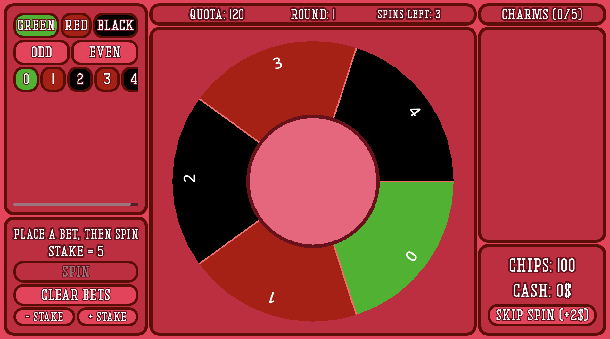
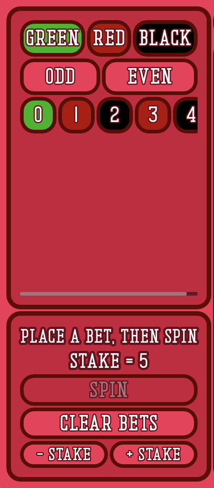
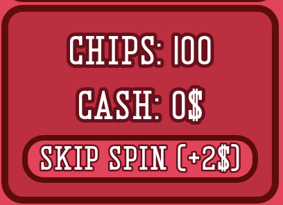
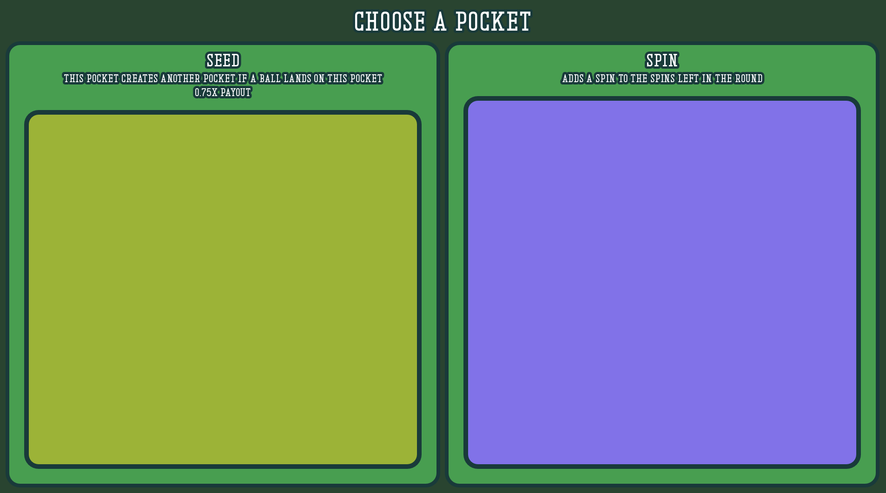
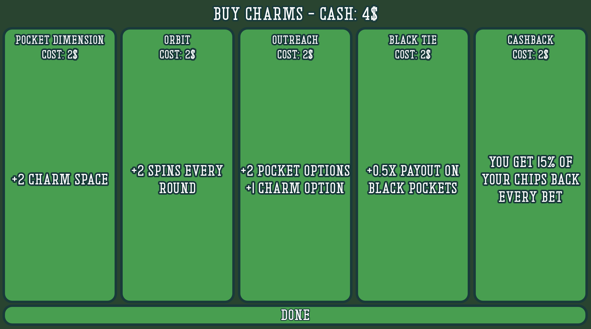

# Roulette Roguelite

A Roguelite based on the roulette casino game, inspired by CloverPit & GWYF  
Made with Godot for Hack Club's Terra - [Try it Out!!](http://ruzet.itch.io/roulette-roguelite)  

## How to play

* Place bets on the betting table in order to gain more Chips!  

* You get 3 spins every round (can be increased through various methods)!  
* You can skip skins in order to gain more Cash!  
 
* After every quota, you can add a Pocket and buy Charms in order to make more Chips  
  
  
* If you run out of chips or dont reach quota and reach 0 spins, you lose!  

## What Works

Right now, only a few features work including:  
* Spinning
* Getting pockets & charms
* Seeded runs
* Losing

